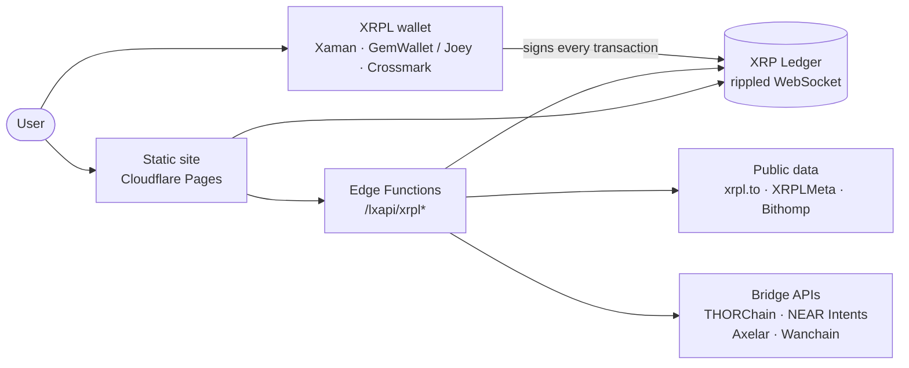

<div align="center">


# LumosCore on XRPL

**Non-custodial trading, liquidity and cross-chain transfers on the XRP Ledger.**

[](https://lumoscore.com/trade/xrpl)
[](https://xrpl.org)
[](https://pages.cloudflare.com)
[](LICENSE)

[**Open the app**](https://lumoscore.com/trade/xrpl) · [Pools](https://lumoscore.com/pools/xrpl) · [Bridge](https://lumoscore.com/bridge/xrpl) · [Launchpad](https://lumoscore.com/launchpad/xrpl) · [Rewards](https://lumoscore.com/rewards/xrpl) · [LUMOS token](https://lumoscore.com/lumos/xrpl)

</div>

---

## Overview

### Finance should not be fenced in by networks

Value today lives on dozens of blockchains, and each one is its own walled garden: its own wallets, its own
exchanges, its own bridges, its own rules. Liquidity is scattered. Moving between networks means trusting a
middleman, juggling tools and hoping nothing breaks on the way. The more networks the world adopts, the worse
this gets.

**LumosCore is built to end that fragmentation.** One platform where anyone can issue an asset, trade it, provide
liquidity, earn rewards and move value across networks, with one experience everywhere and without ever giving up
control of their funds.

### Self-custody is not a feature. It is the foundation.

LumosCore never touches a user's keys. Every swap, order, deposit, launch and transfer is a transaction the user
signs in their own wallet. There are no accounts to create, no balances held on anyone's behalf and no withdrawal
queue to wait in. If LumosCore disappeared tomorrow, every user's assets would still be exactly where they are: in
their own wallets, or in the on-chain pools and order books they chose, withdrawable by them alone.

That is the line we will not cross on any network: **financial freedom means owning your money outright.**

### One platform, many networks

LumosCore is live on **Stellar**, the **XRP Ledger** and **NEAR Protocol**, all served from a single site, with more
networks on the way. A chain switcher moves between them. Each network keeps what makes it strong: its native
assets, its own exchange venues, its own wallets. LumosCore brings them together under one interface and one
standard of quality, with bridges between them built in.

### Why the XRP Ledger

XRPL has run a **decentralised exchange inside the protocol since 2012**, years before the idea had a name. Order
books are ledger objects, not contracts, and the AMM added in XLS-30 sits beside them in the same ledger, so a swap
can draw on both at once. Settlement takes three to five seconds, fees are fractions of a cent, and there is no
contract to audit underneath a trade because there is no contract.

The ledger is also unusually explicit about what an account owes: trustlines, offers and AMM positions each carry a
reserve, and the ledger will tell you exactly what it is. That honesty is worth building on — it means a wallet can
show a user what they can actually spend rather than a balance that lies.

This repository is that XRPL build: trading, limit orders, AMM pools, cross-chain bridging, a wallet, a token
launchpad and LUMOS rewards, served worldwide from Cloudflare's edge.

> **Your keys never leave your wallet.** Every action is a transaction you approve in your own XRPL wallet.
> LumosCore holds no keys, takes no custody and runs no account system.

## Features

| | |
|---|---|
| **Trade** | Token pages with live price, charts, holders, pools and recent trades. Swaps routed across XRPL's order books and AMM pools, plus limit orders placed directly on the ledger. |
| **Pools** | Every curated AMM pool with liquidity, 24h volume and fees. Create a pool, add or withdraw liquidity, and browse the **Rewarded Pools** that earn LUMOS. |
| **Bridge** | Move assets off XRPL and back over **THORChain**, **NEAR Intents**, **Axelar** and **Wanchain**, with each route's fees and timing shown up front. |
| **Wallet** | Balances, send and receive, trustlines, LP positions, open offers (cancel, collect, claim) and a decoded activity history. |
| **Launchpad** | Issue and launch an XRPL token end to end. |
| **Rewards** | The LUMOS Native LP, Ecosystem LP and Whale Holder programmes. |
| **Dashboard** | Network stats, trending tokens, markets and live Platform Activity. |

**Supported wallets:** Xaman, GemWallet (its desktop extension, and the Joey app on mobile) and Crossmark.

## Architecture



- **Static site.** Every page is pre-built HTML with its XRPL logic injected as layers, served from Cloudflare Pages.
- **Edge Functions.** A thin layer that caches public data, shields upstreams from rate limits and never holds user
  funds or keys. It is **owned by the Stellar repository** and synced in here — see below.
- **Ledger first.** Anything the ledger can answer is asked of the ledger, and an aggregator is used only where the
  ledger structurally cannot answer. rippled has no global name index, for instance: you can ask it about an issuer
  address or a `CODE+ISSUER` pair, but never "which tokens are called xyield".
- **Honest data.** A value that cannot be read is shown as unknown, never as zero.

## Data sources

| Source | Used for |
|---|---|
| `xrplcluster.com`, `s1`/`s2.ripple.com` | Balances, trustlines, order books, AMM pools, account transactions, reserves and fees |
| xrpl.to | Token search, prices, holder counts and market data |
| XRPLMeta | Token metadata and issuer information |
| Bithomp | Explorer links and account name lookups |
| THORChain, NEAR Intents, Axelar, Wanchain | Bridge quotes, transfer status, claims |

## Getting started

> **This repository cannot be built from a fresh clone, and a push to it deploys nothing.** Both are deliberate;
> read this section before trying either.

```bash
npm run build         # LOCAL build  -> dist/        (extract_site.js with --root)
npm run build:deploy  # SHIPPING build -> dist/xrpl/  (non-root; what the combine reads)
npm run serve         # local server on :8082
npm run check         # the predeploy gate
npm run idem          # two consecutive runs must produce byte-identical output
npm test              # core unit tests
```

⚠️ **`npm run build` is not the build that ships.** It passes `--root`, which lays the site out at the root for
local browsing. The build that goes into the combined site is the non-root `npm run build:deploy`, which writes
`dist/xrpl/`. A leftover `--root` build sitting in `dist/*.html` will be served in preference to `dist/xrpl/`, which
is a reliable way to spend an hour testing the wrong files.

### What a clone does not give you

Unlike the Stellar repository, **neither the design containers nor `dist/` are tracked here.**

```text
lumoscore-xrpl-desktop.html   design containers — NOT in git (size)
lumoscore-xrpl-mobile.html
dist/                         build output — NOT in git
```

So a clone cannot be built, served or hosted on its own. This repository records *changes to the build*, not a
distributable copy of the site. The npm scripts also call the Stellar repository by **absolute path**
(`node C:/LumosCore/_tools/shared_functions.js .`), so without `C:\LumosCore` checked out alongside it, `build`,
`check` and `sync:functions` all fail. That is a known rough edge, not a design choice.

### Transforms

`_tools/` holds 86 scripts; **64 are registered in `_tools/rebuild.js`**, which is the pipeline. A script that is
not registered does nothing on a rebuild no matter how correct it is — if a change isn't appearing, check
registration first.

**Never run an `_xrpl*` transform on its own.** Each one strips and re-inserts its own layer, so running one in
isolation moves it to the end of the cascade and silently reorders the stylesheets relative to every layer the full
pipeline would have placed after it. Run `rebuild.js`.

Transforms rewrite the **containers**, not `dist/`. Reading `dist/` straight after running one shows the previous
build — run the extract step first.

### Releasing

**A push to this repository deploys nothing.** There is no Cloudflare Pages project attached to it, and
`npm run deploy` now refuses and explains why: it used to run a wrangler deploy against a Pages project named
`lumoscore-xrpl` that does not exist, and whose name wrangler would have offered to *create*, producing a stray
public site serving a half-built tree.

XRPL reaches production only through the combined build: `npm run build:deploy` here, then the combine step in the
deploy repository, which merges the networks into the single tree that is uploaded to Cloudflare.

## Project structure

```text
_tools/                  build: rebuild.js runs the transform chain, extract_site.js writes the site
  _xrpl*.js              one transform per concern (pools, bridge, rewards, FAQ, copy...)
  browser/               the page layers: swap, bridge, pools, wallet, search, charts...
  xrpl-core.js           shared ledger maths — reserves, spendable balance, fees
functions/               30 Cloudflare Pages Functions; 27 are synced copies (see below)
shared-functions.json    which Functions are owned by the Stellar repository
docs/                    images for this README
XRPL_FACTS.md            verified on-chain constants
XRPL_PARITY_AUDIT.md     where this build does and does not match Stellar
```

### Cloudflare Functions

30 Functions live here, but **27 of them are copies.** `shared-functions.json` lists the files that are owned by the
Stellar repository and synced in:

```bash
npm run sync:functions    # pull the shared Functions from C:\LumosCore
npm run check             # among other checks, verifies the copies are in sync
```

Edit a shared Function **in the Stellar repository** and sync it here. Editing the copy means the next sync silently
overwrites your change.

## XRPL behaviour that differs from Stellar

The two builds look alike and the ledgers do not behave alike. The differences that have actually caused bugs here:

- **An open offer reserves nothing.** On Stellar an open order locks reserve; on XRPL it does not. Anything that
  reasons about "spendable balance" must ask this per network rather than assume.
- **Trustlines cost reserve** — 0.2 XRP each — and a pool-share trustline costs **two** reserves, not one. A
  receiving account without the trustline cannot be paid.
- **`base_fee_xrp` is the reference fee, not the fee.** Submitting at the reference fee under load queues the
  transaction, which then expires. It does not fail loudly.
- **Currency codes longer than three characters are 40-character hex**, and non-ASCII codes are normal. Anything
  that assumes a plain ASCII code will 404 its own links.
- **The ledger has no name index.** Token search has to go through an aggregator; only identifier-shaped queries
  (an issuer address, or `CODE+ISSUER`) can be answered from the ledger itself.

## Security

- **Non-custodial by design.** No code path can move funds; every write is a transaction the user signs.
- **No secrets in the repository.** API keys live as Cloudflare secrets (`wrangler secret put`) and `.env*` is
  ignored. Xaman's API secret is server-side only and never reaches the browser.
- **Hostile input handled as such.** Token codes, names and issuer domains come from an issuer anyone can be, so
  they are rendered as text, never as HTML, and never trusted for identity.
- **Xaman's signing popup must be opened inside the user's own tap.** Opening it after an `await` is blocked by the
  browser as an unrequested popup, which presents to the user as "signing does nothing".

Found a vulnerability? Please report it privately through [lumoscore.com/support](https://lumoscore.com/support)
rather than opening a public issue.

## Related repositories

| Network | Repository |
|---|---|
| Stellar (and the shared edge Functions) | [RazaRizv1/lumoscore](https://github.com/RazaRizv1/lumoscore) |
| XRPL | **This repository** |
| NEAR | [RazaRizv1/lumoscore-near](https://github.com/RazaRizv1/lumoscore-near) |

The parent repository's `LUMOSCORE_DEV.md` and `GUARDRAILS.md` apply to this build too; the container pipeline,
transform ordering rules and escaping traps are the same ones.

## License

Released under the [MIT License](LICENSE).
